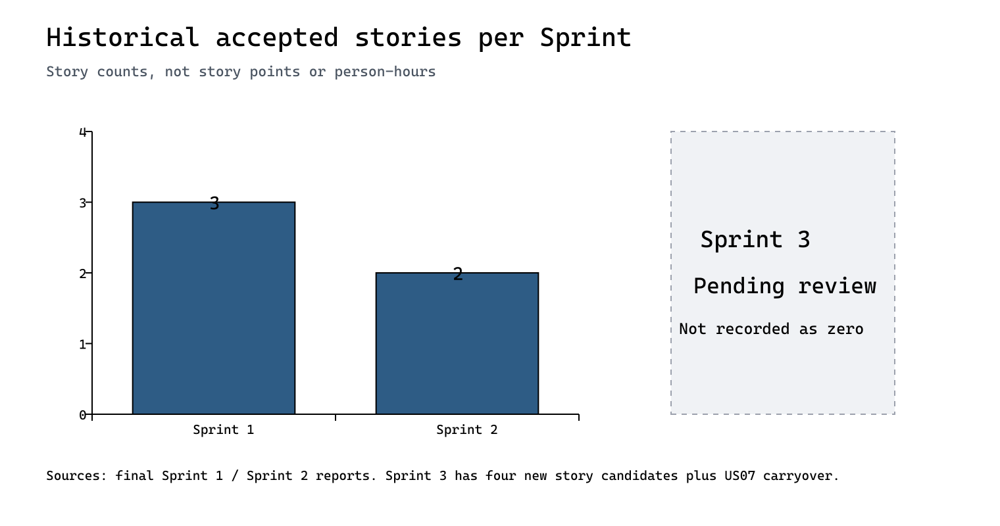
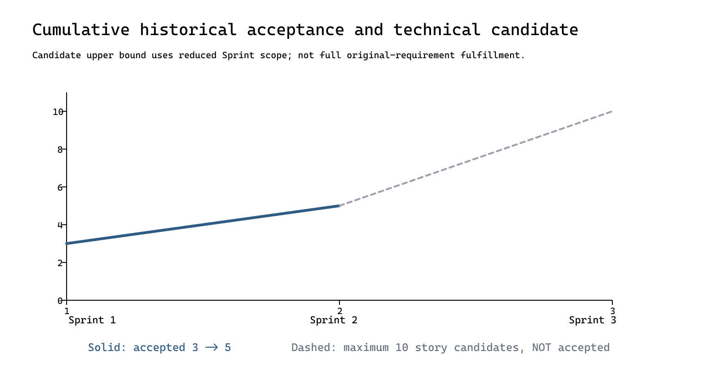

# 三轮度量汇总与图表

数据来自用户现存的正式Sprint1/Sprint2提交包及1eef8df工程候选。逐源条目与SHA256见sources/manifest.json；可编辑原始表为sprint-metrics.csv。以故事数为单位，不换算故事点、工时或个人贡献率。

| 轮次 | 当轮选定故事 | 历史严格完成故事 | 工程与验收说明 | 自动回归快照 |
| --- | --- | --- | --- | --- |
| Sprint1 | US01/04/05，3项 | 3项 | 正式最终自评报告记录Review及Demo通过；服务状态修复属于评审后交付修订 | 评审时24，最终交付35 |
| Sprint2 | US06/07/10，3项 | 2项：US06/10 | US07页面缺口记部分达成；人工合并diff签字不等同浏览器完整DoD | 62，另有23项兼容联调 |
| Sprint3 | US02/03/11/12，4项；另补US07视图 | 尚待本轮人工评审 | 技术候选4项＋结转US07，不能直接记4完成或5完成，也不记0冒充最终速率 | 139，含严格E2E2项；CI22/24通过 |

累计历史接受为3→5。本轮候选若按后续缩减范围经批准接受4个新故事和结转US07，独立故事候选上界为10；虚线不是已完成曲线。原US06/07完整规划仍有缺口，不能将这个上界解释为原十项Must验收全部满足。人签字后才能更新最终接受数。

测试数量35/62/139是各版本的自动测试条目计数，包含不同粒度的领域/接口/策略测试，不是速率、覆盖率或质量评分。严格E2E2项已经包含在139中，单独复跑不累计为141项。

## 不计算的指标

没有同口径课堂工时、故事点估算、实际投入和独立用户样本，不能给出效率提高百分比、实际偏差率、个人贡献或满意度。源数据缺失时CSV空白表示未知，不能补零。

Sprint2自评一处记录16项计划完成15项，但其燃尽附录终点剩余2项；两者算术不一致。已保留原文，不任选一个制造精确任务完成率，也不绘制不可靠的任务燃尽。待何健翔结合原始记录澄清。
